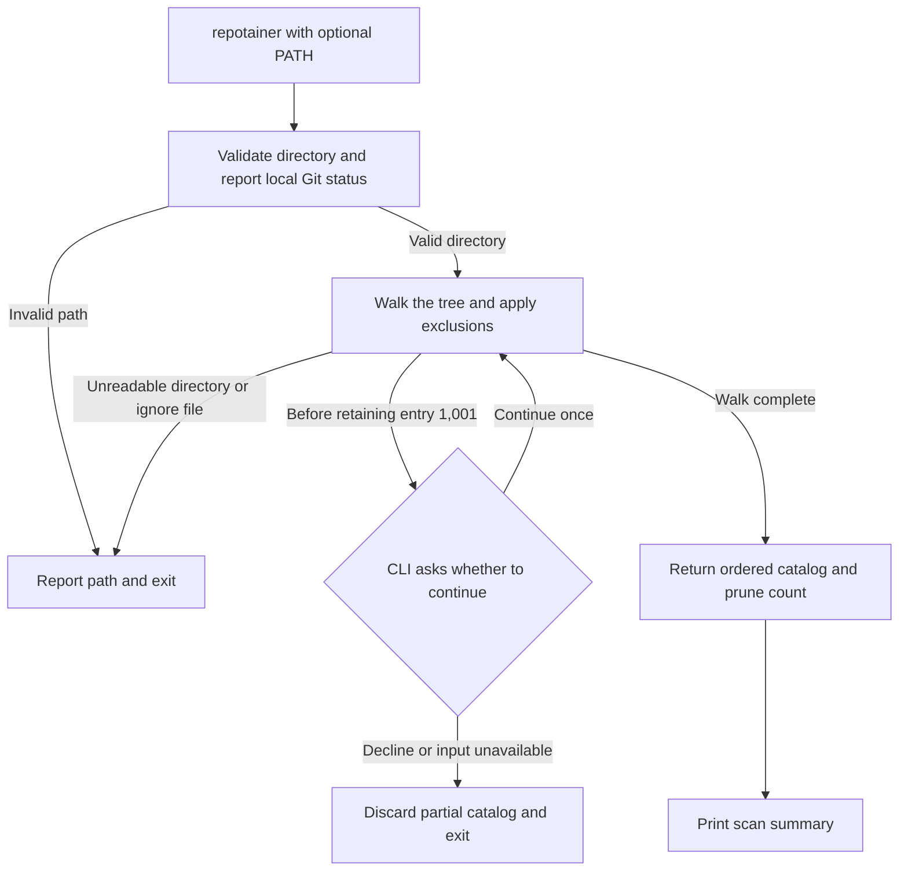

# Repository inventory

- Updated: 2026-11-21
- Author: Suchi Pragya
- Review status: The author approved the A-01 and A-02 resolutions. Implementation decisions for the remaining cases are recorded below and have not had a follow-up EGM review.
- Implementation state: Implemented in the working tree. See [Repository inspection](repository-inspection.md) for the source contract and [Implementation verification](#implementation-verification) for the checks.

## Overview

Run `repotainer [PATH]` to inventory the selected directory. With no argument, it starts in the current directory. The inventory milestone produced one in-memory catalog and reported a scan summary. The command now uses that catalog to collect and print evidence. [CLI evidence output](cli-evidence-output.md)

## The problem

The previous `repotainer detect` command reported the selected path and its Git context. Future detection rules need a common view of the files in the project. If each rule walks the tree itself, it can duplicate work and apply different exclusions. A flat list of filenames would also lose the locations that distinguish two files with the same name. [Repository inspection](repository-inspection.md)

## Goals

- Use one Typer command, `repotainer [PATH]`, with the current directory as the default. Accept directory targets only. Report whether the scan root has a `.git` directory and walk it either way.
- Walk the selected tree once, including eligible files in nested repositories and checked-out submodules. Apply `.gitignore` files from the scan root and its descendants equally to tracked and untracked paths. Use a central list of built-in exclusions starting with `.git`, `.venv`, and `node_modules`. Skip symlinks and fail with the affected path if an included directory or applicable `.gitignore` is unreadable.
- Keep the read-only catalog in memory for one invocation. Store each entry's relative path components, kind, and optional extension. Derive the filename, parent, and depth from the components.
- Warn and ask before retaining more than 1,000 catalog entries. Keep the default easy to change as the project gains experience with larger scans.
- Give later rules a shared catalog they can use to find files by name, location, and extension.

## Non-goals

- Ecosystem detection, project selection, parsing project declarations, and choosing tools or versions.
- Generating, changing, or installing development environment configuration, including dry-run generation previews.
- Persisting or exporting the catalog, adding a separate inventory subcommand, or fetching missing submodule content.

## Critical user journeys

### Inventory a selected subdirectory

- **Given** `apps/web` is inside a Git repository and has its own `.gitignore` and `package.json`.
- **When** the user runs `repotainer apps/web`.
- **Then** Repotainer reports Git status for `apps/web` and applies ignore rules from that directory and its descendants. The scanner returns a catalog scoped to `apps/web`, and the command prints the scan summary.

### Decide whether to continue a large scan

- **Given** the scan has retained 1,000 entries and finds one more eligible entry.
- **When** Repotainer asks whether to continue.
- **Then** confirmation resumes the same walk. A successful walk returns the complete catalog. Declining discards the buffered entries and ends the run.

## Technical plan

The command resolves the scan root and reports its Git status before starting the walk. The scanner walks the tree once, applying exclusions and collecting entries and counts. The command receives the completed catalog and prints a summary. Future detection rules can consume the same catalog in the same process.

### Component responsibilities

| Component | Proposed change |
| --- | --- |
| [CLI entry point](../../src/repotainer/cli.py) and [command handler](../../src/repotainer/commands/main.py) | Register one command that accepts an optional directory path. The command reports whether the scan root contains a `.git` directory, handles the large-scan prompt, and prints either a summary or a path-specific error. |
| [Path and repository inspection](../../src/repotainer/scanning/repository.py) and [path handling](../../src/repotainer/scanning/paths.py) | Validate the directory target and supply the resolved scan root and local `.git` directory status before traversal. The inventory workflow uses the scan root for this check in place of the current ancestor search. |
| Inventory builder in `scanning/` | Own the filesystem walk, built-in exclusions, scoped ignore rules, catalog entries, and prune count. Return the complete result on success. Keep terminal input and output in the command layer. |
| Future detection rules | Use the completed catalog to locate candidates by file path, kind, and extension. Open selected declarations only when a rule needs their contents. |

### Command interface

This interface describes the inventory milestone. The command's evidence output is documented in [CLI evidence output](cli-evidence-output.md).

`PATH` is an optional positional argument. `repotainer` inventories the current directory, and `repotainer ./project` inventories the supplied path. Typer generates `repotainer --help` from the argument and option definitions. The [root command design](root-command.md) defines how inventory and future stages fit into the single command.

For the old `repotainer detect [PATH]` invocation, drop `detect` and remove `--allow-no-git` if present. If the old argument was a file, pass its parent directory explicitly. Scripts that parsed the previous path and Git context now receive inventory counts. A bare `repotainer detect` is parsed as a request to scan a directory named `detect`. Use `repotainer` to scan the current directory or `repotainer ./detect` to make that directory target explicit.

### Choose the scan root

Default to the current directory. Reject an explicitly supplied target whose final entry is a symlink or junction. Resolve other targets strictly and require a directory. Reject a resolved root that is a `.git` directory or lies inside one. Report the supplied path on failure. The resolved directory is the boundary for the walk.

| Condition | Behavior |
| --- | --- |
| The target is a regular file or a symlink | Report that a directory is required and exit before walking. |
| The scan root has a `.git` directory | Report that Git metadata is present at the scan root and start the inventory. |
| The scan root has no `.git` directory | Report `No .git directory found at <scan root>. Continuing with inventory.` and start the walk without asking. A regular `.git` file or a symlink is insufficient for this status check. |

Check `.git` with filesystem metadata at the scan root only. Inventory proceeds whether or not a `.git` directory is present. An unexpected metadata error is reported with the path and stops the scan. A selected Git worktree is scanned as an ordinary directory. The scanner leaves `.git` contents and references unread.

### Traversal and exclusions

Use one Python filesystem walk. Read regular `.gitignore` files encountered in directories the walk enters, then apply their patterns before descending. Inherited patterns stay scoped to the directory that supplied them. Apply parent rules first, then deeper rules. The last matching rule wins, and negation can re-include an entry only when its parent directory is still visited. The supported v1 syntax is defined in [Scoped ignore matching](#scoped-ignore-matching). [Git's ignore pattern reference](https://git-scm.com/docs/gitignore#_pattern_format)

When entering a directory, combine its applicable `.gitignore` rules with the inherited rules for that branch. For each child, determine its kind without following symlinks, apply the built-in exclusions and then the applicable ignore rules, and add only included entries to the catalog. Descend only into included directories. A directory's rules apply to its descendants and fall out of scope when the walk moves to another branch.

The ignore scope is the scan root and its descendants, including for a scan that proceeds without a local Git marker. For example, `repotainer apps/web` uses `apps/web/.gitignore` and applicable files below it. The repository-level `.gitignore` above `apps/web` is outside that scope. Apply the same rules to tracked and untracked paths. Skip a path when the applicable rules exclude it, even if Git tracks it. The walk uses `.gitignore` files as its source of project ignore patterns and is independent of the Git index, user-level ignore settings, and repository-local Git excludes.

- Keep built-in exclusions in one scanner policy so new names can be added in one place. Exclude `.git` entries, and prune directories named `.venv` or `node_modules` at any depth. These exclusions take precedence over `.gitignore` negations. Other virtual environments and dependency directories can be excluded by repository rules.
- Include hidden paths subject to ordinary exclusion rules. For example, `.python-version` and `.devcontainer/devcontainer.json` can be significant inputs for later stages.
- Skip symlinks before adding entries or descending. This applies to links to files or directories, broken links, and symlinked `.gitignore` files. Leave their targets unread.
- Continue walking into nested repositories and checked-out submodules when ordinary exclusion rules allow it. Keep the original scan root, apply applicable ignore rules from within that boundary, and skip each nested `.git` entry. Scan only files present on disk. An uninitialized submodule contributes no manifests, and the scanner never initializes or fetches it.
- Skip special filesystem entries such as FIFOs and sockets without opening them.
- Report an unreadable directory or applicable `.gitignore` with its path and fail the scan. A partial inventory can hide declarations a later rule needs.

Count directories pruned during traversal and show that count in the scan summary. Each pruned directory accounts for its entire subtree. The scanner counts it at the point it skips it and leaves descendants unread. A skipped file or symlink does not add to the directory count.

Use Repotainer's own matcher built on standard-library `pathlib`. Repotainer controls directory scope, precedence, and pruning. Git is used only to verify test fixtures.

### Catalog storage and lifetime

The completed result contains the absolute scan root, the immutable sequence of entries, and the number of pruned directories. The command prints the scan root and counts for retained files, retained directories, and pruned directories. Future rules can combine the scan root with a record's path components to open a selected file. For example, a rule can match `package.json` in a dashboard submodule, use `.json` to choose a reader, and check `packageManager` before planning decides which tools belong in the generated environment.

An extension can also identify a candidate without opening it. A `.py` file can trigger a Python rule. A rule that needs contents can use the same YAML reader for `.yaml` and `.yml`, or a TOML reader for `.toml`. Format readers belong to the later detection stage. For example, a JSON reader can distinguish a missing key, an explicit `null`, and an unreadable or malformed file.

Each catalog entry is a Python named tuple with three fields, in this order.

| Field | Type | Stored value |
| --- | --- | --- |
| `relative_path` | `tuple[str, ...]` | Ordered components below the scan root, preserving original spelling. |
| `kind` | `Literal["file", "directory"]` | Entry type observed during the walk. |
| `extension` | `str \| None` | Last suffix of a regular file, including the dot and preserving case. `None` for directories and files with no suffix. |

The scanner appends entries to a list during the walk. For `apps/web/package.json`, store `(("apps", "web", "package.json"), "file", ".json")`. The component count gives depth `3`. The last component gives the filename, and the preceding components give the parent directory. File size and contents are outside the record. After a successful walk, sort the entries by their component tuples and return an immutable tuple of entries with the absolute scan root stored separately. Join the components with `/` for display when needed.

Reuse Python's standard-library `pathlib`. For an included `Path` yielded by the walk, use `entry_path.relative_to(scan_root).parts` to obtain the component tuple. The walk checks entry kinds and skips symlinks before building records. For regular files, compute the extension once with `entry_path.suffix or None`. These path operations perform no filesystem reads. [Python's `pathlib` documentation](https://docs.python.org/3.14/library/pathlib.html#pathlib.PurePath.parts)

The catalog exists in memory for one invocation. There is no catalog file, output location, or cache to manage. A subsequent invocation builds a fresh catalog. Later export can serialize the result when explicitly requested.

Traversal time depends on how many entries the scanner must inspect and which ignore patterns it must evaluate. Prune excluded directories before visiting their children. Keep memory proportional to the retained records and their path lengths. Sorting adds a cost that grows with the number of retained records. A terminal summary keeps output small while the full catalog remains available to the scanner's caller. Measure scan time and peak memory on representative trees during implementation before deciding whether the storage strategy needs to change.

### Large scans

Start with a threshold of 1,000 catalog entries, counting files and directories after exclusions. Pause before storing entry 1,001. The CLI prompts on stderr and defaults to stopping. Declining or accepting the default discards the partial catalog and exits with status `1`. EOF or interrupted input exits with status `2` and an error. Both omit the success summary. Confirmation resumes the same walk without repeating work or asking again. The scanner calls a callback with the scan root and threshold. A decline returns `None`, and other failures propagate to the command.

This threshold protects against accidentally retaining a large catalog, including when someone explicitly selects a virtual environment as the scan root. It is a confirmation threshold. Once the user continues, catalog size can grow beyond 1,000 entries. Time spent inspecting entries later excluded by ignore rules is independent of the retained entry count. Regular files of any size contribute a path, kind, and optional extension. The existing `.gitignore` reads are for traversal control.

### Catalog invariants

- The result carries the absolute scan root and an ordered collection of entries. Each entry has a unique root-relative path, a kind, and an optional extension. Sort paths lexicographically by their components, so a directory precedes its descendants.
- The root itself has no catalog row. A direct child has one path component and depth `1`. `archive.tar.gz` has extension `.gz`. Extensionless files, dotfiles such as `.gitignore`, and directories such as `samples.json/` have extension `None`.
- Identical visible paths, metadata, and traversal rules yield the same catalog order. The scanner skips observed links and assumes entries stay in place between metadata checks and access. A scan is not a snapshot or protection against concurrent replacement.

### Side effects

Scanning reads directory entries, file metadata, and applicable `.gitignore` contents. The milestone leaves project declarations unopened and performs no file writes, project execution, network activity, or Git subprocess calls. The command handles terminal input and output.

## Alternatives considered

| Alternative | Benefit and trade-off | Decision |
| --- | --- | --- |
| Keep inventory under `repotainer detect [PATH]` | Preserves the pre-cutover invocation and provides a standalone inspection command. It also introduces a command boundary before there is a standalone export or diagnostic workflow to justify it. | The author chose `repotainer [PATH]` for the first milestone. The [root command design](root-command.md) carries forward the single-command decision. |
| Require Git or ask before scanning without it | A Git check can help identify a likely project root, but requiring Git or confirmation interrupts valid scans of ordinary directories and selected subdirectories. | The author chose to report local Git status and proceed with every valid directory. |
| Find the containing Git root and inherit its ignore rules | Scans of a repository and one of its subdirectories would share the repository's exclusions. This requires reading configuration above the path the user selected. | The author chose the selected directory as the boundary for inventory and `.gitignore` files. |
| Use Git's tracked-file list or preserve tracked exceptions to `.gitignore` | Listing tracked files limits the scan to versioned content but misses untracked declarations. Preserving tracked exceptions includes force-added files but requires consulting Git's index and gives different filtering behavior to folders without Git. | The author chose a filesystem walk that applies in-scope ignore patterns equally to tracked and untracked paths. |
| Stop at a nested repository's `.git` marker | Keeps separate checkouts out of the outer inventory. It can also hide tool requirements for checked-out submodules that belong in the selected development environment. | The author chose to inventory eligible nested contents and skip `.git` entries. Later planning decides which requirements apply to the environment. |
| Match extensions alone | Provides a small format index, but loses the names and locations that distinguish `package.json`, extensionless markers, and matching filenames in different directories. | The catalog preserves full relative path components, entry kind, and optional extension for later rules. |
| Persist or export the catalog in v1 | A JSON file could support inspection and reuse across runs. It also adds an output location, a serialization contract, and decisions about whether an older catalog is still current. | Deferred. The first milestone shares an in-memory catalog within one invocation. |
| Use PathSpec for ignore patterns | Supplies a pattern compiler, but the reviewed integration pruned `generated/` under `generated/**` and kept a nested text file under `*`, `!*/`, and `!*.json`. | Superseded by the author-approved standard-library matcher. |
| Use `gitmatch` for ignore patterns | An isolated probe of the tagged release source matched Git on the 15 checked cases. Adopting it would make long-term matcher fixes depend on a third-party package. | The author chose to own the matcher and its maintenance. |
| Use `git check-ignore` at runtime | Delegates semantics to Git. An isolated probe matched the selected-directory scope using temporary Git metadata. | Git stays a test tool so Repotainer can run on machines without the Git executable. |

## Open questions

- **Scan limits.** The measurements below cover flat directories. Measure more deeply nested or rule-heavy trees if they show noticeable delay or memory growth before the retained-entry prompt.

## Detailed Implementation Plan

### Delivery order and files

The two checkpoints below describe the completed delivery sequence.

#### Checkpoint 1 · Build and verify the scanner

Build the matcher and inventory builder for callers that supply an already validated directory. The existing `repotainer detect` command, inspection contract, and tests continue to work at this checkpoint.

| File | Change | Purpose |
| --- | --- | --- |
| `src/repotainer/scanning/ignore.py` | Create | Parse each visited directory's `.gitignore` once and match the supported syntax using `pathlib`. Keep parsed rules with their owning directories. |
| `src/repotainer/scanning/inventory.py` | Create | Define the catalog entry, result, and inventory builder. Walk directories incrementally, prune excluded children, count pruned directories, and use the confirmation callback before retaining entry 1,001. Return only a completed catalog. |
| `tests/test_inventory.py` | Create | Cover filesystem and matcher behavior in temporary directories, including scoped rules, both matcher regressions, pruning, ordering, and cancellation. Inject filesystem failures where permissions are unreliable across environments. |

Run `uv run python -m unittest discover -s tests` and `uv run repotainer detect --help`. The existing inspection and CLI tests and the new scanner fixtures must pass together.

#### Checkpoint 2 · Switch inspection and the CLI together

Update path validation, repository inspection, the command and its tests, and the corresponding docs in one checkpoint. The new command calls the already tested inventory builder after validating the directory. Retire the old path and Git inspection behavior in the same checkpoint as its callers and tests.

| File | Change | Purpose |
| --- | --- | --- |
| [src/repotainer/scanning/paths.py](../../src/repotainer/scanning/paths.py) | Modify | Expand `~`, reject a final-component symlink, resolve strictly, and require a directory. Remove file-to-parent behavior from the inventory path. |
| [src/repotainer/scanning/repository.py](../../src/repotainer/scanning/repository.py) | Modify | Return the absolute scan root and whether it has a real `.git` directory. Treat an absent `.git` entry as missing, propagate other metadata errors, and retire the ancestor lookup. |
| [src/repotainer/cli.py](../../src/repotainer/cli.py) | Modify | Register the inventory handler as the single Typer command. Keep `repotainer.cli:main` as the installed entry point. Remove the subcommand registration and the help-on-empty root callback. |
| `src/repotainer/commands/detect.py` | Modify | Adapt the handler to accept the optional directory, report local Git status, supply the large-scan callback, and render the summary or an error. Remove `--allow-no-git`. |
| [tests/test_repository.py](../../tests/test_repository.py) | Modify | Replace tests for the old Git prerequisite and ancestor lookup with tests for the new inspection contract and main command. Use `CliRunner` to verify explicit and omitted directory arguments. |
| [README.md](../../README.md) | Modify | Describe the actual installed invocation and inventory behavior. |
| [docs/designs/repository-inspection.md](repository-inspection.md) | Modify | Reconcile the current source contracts with the updated inspection and CLI. |
| `docs/designs/repository-inventory.md` | Modify | Record the implemented matcher behavior, verification results, and observed scan measurements. |
| [docs/designs/SITEMAP.md](SITEMAP.md) | Modify | Update implementation and verification status after the cutover checks pass. |

Run `uv run python -m unittest discover -s tests`, `uv run repotainer --help`, and `uv run repotainer <fixture-directory>` with a small directory that has no `.git` entry. Verify that the scan completes and reports its catalog counts. Use a CLI test to exercise `repotainer` from the fixture directory with no argument. Run the additional repository checks listed under [Verification criteria](#verification-criteria).

### Scoped ignore matching

Parse each `.gitignore` into ordered rules with their source lines, scope, exclusion or re-inclusion effect, directory-only flag, and normalized pattern. For each entry, supply its path relative to the rule file's directory and its kind. Use `PurePosixPath.full_match()` with explicit case sensitivity for normalized globs. The parser handles Git escape syntax before passing a pattern to `pathlib`. Keep the directory-only flag separate because `pathlib` drops trailing slashes. [Python `full_match()`](https://docs.python.org/3.14/library/pathlib.html#pathlib.PurePath.full_match)

| Supported rule | Behavior |
| --- | --- |
| Plain names and basic wildcards | A bare pattern matches at any depth below its ignore file. `*` and `?` operate within a path component. Support basic bracket sets, ranges, and negated sets such as `*.py[codz]`, `[a-z]`, and `[!0-9]`. |
| Anchored and directory-only patterns | A leading or interior `/` anchors the pattern to the directory containing the ignore file. A final `/` restricts a match to directories, so an unanchored `cache/` can match directories at any depth. |
| Recursive wildcards | Support leading `**/`, trailing `/**`, and interior `/**/`. For example, `generated/**` matches descendants while leaving `generated/` eligible for traversal. |
| Negation | An unescaped leading `!` explicitly re-includes a matching entry. The last applicable match wins within an ignore file. |
| Comments, blank lines, and escaping | Skip comments and blank lines. Honor backslash escapes such as `\#notes`, `\!important`, and `literal\*.txt`. Strip unescaped trailing spaces and preserve escaped trailing spaces. |

Read `.gitignore` as UTF-8 with optional BOM and accept LF or CRLF. A regular ignore file still supplies rules if a rule excludes its own catalog entry. Use case-sensitive matching and count filename bytes for `?` and bracket expressions. `pathlib` handles ordinary component globs and the matcher uses regular expressions to preserve escape meaning inside character classes. Malformed patterns such as a dangling backslash or unclosed character class do not match. Unsupported POSIX character classes stop the scan with the file path and line number. A read or decoding failure stops the scan and reports the affected path.

For one rule set, return exclusion, explicit re-inclusion, or no match as distinct outcomes. A re-inclusion in a deeper file can override a matching parent rule. A no-match result passes the decision to the next shallower rule set.

Check applicable rule sets from the deepest directory outward. Stop at the first explicit exclusion or re-inclusion. A no-match result passes the decision to the next shallower rule set. A path with no explicit match is included. Built-in exclusions take priority, and a negation cannot bring back an entry beneath a directory the scanner has already pruned.

### Scanner sequence

1. Start from the validated directory. Use incremental directory enumeration with `os.scandir` and retain `Path` objects for relative-path handling. An explicit stack holds one iterator for each active directory. Inspect metadata without following symlinks, and close iterators on completion, cancellation, and failure.
2. When the walk enters a directory, check for a regular `.gitignore` and add its compiled rules to the active branch. Process children against built-in exclusions first, then evaluate rule sets from deepest to shallowest until one explicitly matches. This preserves the precedence described in the technical plan. Remove the directory's rules when leaving the branch.
3. Skip links and other unsupported kinds. When excluding a directory, increment the prune count and leave its contents unread. For an included entry, derive the relative components and optional suffix using `pathlib`. Before appending the first entry over the threshold, call the CLI decision callback once. Continue the same walk on approval. On decline or unavailable input, exit without publishing the buffered catalog.
4. On directory iteration, entry classification, or ignore-file failure, report the affected path and stop before returning a result. On success, sort entries by their path components and freeze them. Return the absolute root, ordered entries, and prune count. Derive the retained counts from those entries in the command summary.

### Verification criteria

Use temporary directories and the existing unittest runner.

| Scenario | Expected result |
| --- | --- |
| `repotainer`, explicit directory, explicit file, invalid path, and `--help` | An omitted path uses the current directory. Valid directories become the scan root. File and invalid targets fail before scanning. `--help` displays usage. |
| Root `.git` directory or file, ancestor-only marker, and no marker | Only a local `.git` directory is reported as present. Every valid directory is scanned without a Git confirmation prompt. A `.git` file is skipped without reading its contents. |
| Subdirectory scan with an ancestor `.git` and an ancestor `.gitignore` | The command checks only the selected root for Git and uses ignore files at and below that root. A path excluded only by the ancestor file appears in the catalog. |
| Parent and child ignore patterns, anchored patterns, negation, and pruned parents | Matching uses the correct scope and rule order. A negation cannot restore a child of a pruned directory. |
| Nested rule `/generated/` and a regular file also named `generated` in a separate fixture | The anchored rule excludes the directory directly below the rule file. It leaves deeper directories with the same name and the regular file visible. |
| Root rule `*.log`, child rule `!keep.log`, and a sibling directory without a negation | Save `keep.log` in each directory. Include it only beneath the child rule. Other `.log` files beneath that child remain excluded when the child rule has no match. |
| `generated/**` followed by `!generated/keep.txt` | Retain `generated/` and `generated/keep.txt`. Exclude `generated/drop.txt`. |
| `*`, `!*/`, and `!*.json` in that order | Retain directories and JSON files. Exclude nested text files. |
| Bare names, `*`, `?`, bracket sets and ranges, and case | Match only the expected candidates. Check wildcard boundaries at path separators and verify a differently cased path is distinct. |
| Leading `**/` and interior `/**/` | Check depth-independent matches for leading `**/` and verify `a/**/b` matches `a/b` and `a/x/y/b`. |
| Escaped markers, wildcards, and trailing spaces | Treat escaped characters as literal. An escaped initial `#` is a pattern and an escaped initial `!` does not negate a rule. Unescaped trailing spaces are stripped. |
| Unsupported POSIX character class | Fail with the affected `.gitignore` path and line number. Emit no success summary. |
| A tracked file and an untracked file both excluded by an in-scope `.gitignore` rule | Both paths are absent from the catalog. The scanner uses the same filtering with or without a Git index. |
| Built-in exclusions with no ignore files and with negation attempts | Manifests inside `.venv` and `node_modules` are absent in both cases. The summary counts pruned directories. The walk never enters them or counts their contents. |
| Same filename at different depths, compound and uppercase suffixes, dotfiles, extensionless files, and dotted directories | Paths, kinds, extension values, and depth match expectations. Changing file-creation order produces the same catalog order. |
| Successful scan of a large fixture | The command reports counts without listing every path. Compare the filesystem before and after to check that the scan created no files. |
| 1,000 retained entries, followed by a case with 1,001 | The first scan finishes without a size prompt. The second pauses before entry 1,001. Declining discards the partial catalog. Confirming resumes the same walk and returns all entries. Excluded entries do not count toward the threshold. |
| Symlinks to files and directories, broken links, a symlink loop, and symlinked `.gitignore` and `.git` entries | The catalog skips the links and leaves their targets unread. A symlink supplied as the target is rejected before walking. A symlinked `.git` is reported as an absent `.git` directory, and the scan proceeds. |
| Nested repository with a `.git` directory and checked-out submodule with a `.git` file | The walk records manifests from both under the original scan root, skips both `.git` entries, and applies inherited and nested ignore rules. An empty submodule directory contributes no manifests. |
| Unreadable directory, metadata, or applicable `.gitignore` | The command reports the affected path and emits no successful catalog. Active iterators close on the failure path. |

Give unit fixtures explicit expected results so the normal suite can run without Git. Add optional integration checks that compare supported rules against `git check-ignore --no-index` in temporary fixture trees, using case-sensitive matching. Skip those comparisons when Git is unavailable. Use Git as the comparison tool in tests only.

Use a synthetic fixture and instrument file reads to assert that the scan opens only applicable `.gitignore` files, including when a manifest contains invalid data. Use separate large fixtures for a catalog with many retained entries and a directory with mostly ignored entries. Record retained and pruned counts, elapsed time, and peak memory for both. The measurements inform later tuning.

Run the existing repository checks. See [Development checks](../development.md#checks).

| Purpose | Command |
| --- | --- |
| CLI, scanner, and matcher behavior | `uv run python -m unittest discover -s tests` |
| Python lint and format | `ruff check .` and `ruff format --check .` |
| Python types | `ty check` |
| Documentation | `rumdl check AGENTS.md README.md docs` and a local link check |

## Implementation verification

Verified the uncommitted implementation based on `fa5f3ac` on 2026-11-21 with Python 3.14.6 and Git 2.43.0 on Linux. Checkpoint 1 passed 13 tests and displayed `repotainer detect --help`. After the cutover, 22 tests passed, including the optional Git comparison, scanner regressions, confirmation outcomes, and path-specific failures. With `PATH` empty, 21 tests passed and the optional Git comparison was skipped. The installed command also scanned a temporary directory with both omitted and explicit paths in that environment. Ruff lint, Ruff format check, ty, Markdown lint, and local documentation links passed.

Measured the scanner using `perf_counter` and `tracemalloc` on two temporary flat directories. Timing includes tracing overhead and excludes fixture creation. The retained scan approved continuation. The mostly ignored scan stayed below the prompt.

| Fixture | Entries inspected | Entries retained | Directories pruned | Elapsed | Peak traced memory |
| --- | --- | --- | --- | --- | --- |
| All files retained | 10,000 | 10,000 | 0 | 0.194 s | 2.48 MiB |
| 10,000 ignored logs, 20 retained files, one `.gitignore`, one built-in directory exclusion | 10,022 | 21 | 1 | 0.300 s | 0.14 MiB |

These are local fixture measurements. The mostly ignored scan used less catalog memory and still spent time applying ignore rules. The measurements do not establish limits for deeper trees, different filesystems, or larger rule sets.
